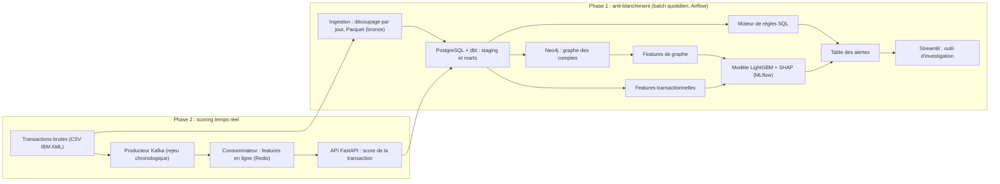

# AML Sentinel

**Détection du blanchiment d'argent par analyse de graphes, complétée par un scoring des transactions en temps réel.**


---

## Sommaire

1. [Pourquoi ce projet](#pourquoi-ce-projet)
2. [Problématique](#problématique)
3. [Objectifs](#objectifs)
4. [Données](#données)
5. [Architecture](#architecture)
6. [Stack technique](#stack-technique)
7. [Plan d'action](#plan-daction)
8. [Journal de bord : attendu vs réalisé](#journal-de-bord--attendu-vs-réalisé)
9. [Résultats](#résultats)
10. [Choix méthodologiques](#choix-méthodologiques)
11. [Limites connues](#limites-connues)
12. [Installation et lancement](#installation-et-lancement)
13. [Structure du dépôt](#structure-du-dépôt)
14. [Auteur](#auteur)

---

## Pourquoi ce projet

Chaque banque est soumise à une obligation de lutte contre le blanchiment de capitaux et le financement du terrorisme (LCB-FT). Concrètement, cela veut dire surveiller en continu les opérations des clients et signaler à Tracfin celles qui paraissent suspectes.

Dans la pratique, cette surveillance repose encore largement sur des **règles fixes** : un virement au-dessus d'un certain montant, une série d'opérations vers un pays sensible, des dépôts fractionnés juste sous un seuil. Ces règles ont deux défauts bien connus :

- **Elles génèrent énormément d'alertes, dont une large majorité de faux positifs.** Les analystes conformité passent une grande partie de leur temps à clôturer des dossiers sans risque réel.
- **Elles regardent les opérations une par une.** Or les schémas de blanchiment les plus courants (comptes mules, circuits en boucle, regroupement de fonds venant de nombreux comptes) ne deviennent visibles qu'en observant le **réseau** des transactions, sur plusieurs jours ou semaines.

À côté de cette surveillance a posteriori, les banques doivent aussi décider **en temps réel** si une opération doit être bloquée ou laissée passer, en quelques millisecondes.

J'ai travaillé en conformité bancaire (KYC / LCB-FT) chez Monabanq. Cette expérience m'a donné une compréhension concrète des obligations de vigilance et de la façon dont les dossiers clients sont analysés. Ce projet est ma manière d'aborder le même problème du côté des données : construire la chaîne complète, de l'ingestion des transactions jusqu'à l'outil qu'utiliserait un analyste.

---

## Problématique

> **Peut-on réduire le volume d'alertes à traiter par les analystes, sans laisser passer davantage de blanchiment, en combinant règles métier, analyse de graphe et apprentissage automatique ? Et peut-on, sur le même flux, scorer chaque transaction au moment où elle arrive ?**

---

## Objectifs

| # | Objectif | Comment le mesurer |
|---|----------|--------------------|
| 1 | Pipeline batch reproductible, traitant une journée de transactions à la fois | Exécution complète via Airflow, tests de qualité au vert |
| 2 | Système de règles métier servant de référence | Nombre d'alertes, rappel et précision mesurés |
| 3 | Modèle combinant features transactionnelles et features de graphe | À rappel égal, réduction du nombre d'alertes par rapport aux règles seules |
| 4 | Chaque alerte est explicable | Explication SHAP lisible pour chaque compte signalé |
| 5 | Outil d'investigation utilisable par un analyste | Application Streamlit fonctionnelle |
| 6 | (Phase 2) Scoring en temps réel | API opérationnelle, latence p95 mesurée (cible : moins de 100 ms) |

---

## Données

**Source :** [IBM Transactions for Anti Money Laundering (AML)](https://www.kaggle.com/datasets/ealtman2019/ibm-transactions-for-anti-money-laundering-aml), publié par IBM (Altman et al., NeurIPS 2023, *Datasets and Benchmarks*).

**Version utilisée :** `HI-Small` (environ 5 millions de transactions, taux de blanchiment plus élevé que dans les versions `LI`).

**Pourquoi des données synthétiques ?** Les données de transactions bancaires réelles sont confidentielles et ne peuvent pas être publiées. Ce jeu est généré par la simulation d'un écosystème financier complet (particuliers, entreprises, banques), dans lequel des opérations de blanchiment sont injectées et **étiquetées**. Il fournit aussi la liste des schémas utilisés (fan-in, fan-out, cycles, empilement, etc.), ce qui permet d'évaluer ce que chaque méthode détecte réellement.

**Principales colonnes :**

| Colonne | Description |
|---------|-------------|
| `Timestamp` | Date et heure de l'opération |
| `From Bank`, `Account` | Banque et compte émetteurs |
| `To Bank`, `Account` | Banque et compte destinataires |
| `Amount Paid`, `Payment Currency` | Montant et devise débités |
| `Amount Received`, `Receiving Currency` | Montant et devise crédités |
| `Payment Format` | Virement, carte, chèque, espèces, crypto, etc. |
| `Is Laundering` | Étiquette (1 = opération de blanchiment) |

Les fichiers de données ne sont pas versionnés dans ce dépôt (voir [Installation](#installation-et-lancement)).

---

## Architecture



Dans une banque, ces deux systèmes coexistent sur le même flux : le scoring temps réel décide au moment de l'opération, la surveillance anti-blanchiment analyse l'historique et le réseau a posteriori. Ce projet reproduit cette organisation.

---

## Stack technique

| Domaine | Outils |
|---------|--------|
| Langages | Python, SQL |
| Stockage | PostgreSQL, Parquet, DuckDB (exploration), Neo4j |
| Transformation | dbt, pandas |
| Orchestration | Apache Airflow |
| Qualité des données | Tests dbt |
| Machine learning | scikit-learn, LightGBM |
| Explicabilité | SHAP |
| Suivi des expériences | MLflow |
| Visualisation | Streamlit, pyvis |
| Temps réel (phase 2) | Kafka, Redis, FastAPI |
| Monitoring (phase 2) | Evidently |
| Industrialisation | Docker, docker-compose, Git, GitHub Actions |

---

## Plan d'action

Le projet est découpé en deux phases. **La phase 1 constitue à elle seule un projet complet** ; la phase 2 l'étend au temps réel.

Légende : ⬜ à faire · 🟨 en cours · ✅ terminé

| Semaine | Thème | Livrable attendu | Statut |
|:-------:|-------|------------------|:------:|
| 1 | Mise en place et compréhension des données | Environnement Docker opérationnel, notebook d'exploration | ⬜ |
| 2 | Entrepôt de données | Couches bronze, staging et marts avec tests dbt | ⬜ |
| 3 | Orchestration et règles métier | DAG Airflow quotidien, alertes par règles mesurées | ⬜ |
| 4 | Analyse de graphe | Graphe Neo4j et table de features de graphe | ⬜ |
| 5 | Modélisation (1/2) | Premier modèle avec découpage temporel | ⬜ |
| 6 | Modélisation (2/2) | Modèle optimisé, comparaison avec les règles, SHAP | ⬜ |
| 7 | Outil d'investigation | Application Streamlit, README v1 | ⬜ |
| 8 | Flux temps réel | Producteur et consommateur Kafka | ⬜ |
| 9 | Scoring en ligne | Features Redis, API FastAPI, latence mesurée | ⬜ |
| 10 | Industrialisation | Monitoring, tests, CI, vidéo de démonstration | ⬜ |

---

## Journal de bord : attendu vs réalisé

Cette section est mise à jour chaque semaine. Elle documente ce qui était prévu, ce qui a réellement été fait, et les décisions prises en cours de route.

### Semaine 1 : mise en place et compréhension des données

**Attendu**
- Créer le dépôt et le fichier `docker-compose.yml` (PostgreSQL, Airflow, Neo4j).
- Télécharger le jeu `HI-Small` et l'explorer avec DuckDB dans un notebook.
- Analyser la distribution des montants, des formats de paiement et des devises.
- Étudier le fichier des schémas de blanchiment pour comprendre ce que l'on cherche à détecter.
- Mesurer le déséquilibre des classes.

**Réalisé**
- _À compléter_

**Difficultés et décisions**
- _À compléter_

---

### Semaine 2 : entrepôt de données

**Attendu**
- Script d'ingestion qui découpe les transactions par jour et les écrit en Parquet (couche bronze).
- Chargement dans PostgreSQL.
- Modèles dbt `staging` : nettoyage, typage, identifiants de comptes uniques (banque + compte).
- Modèles dbt `marts` : dimension comptes, faits transactions, agrégats quotidiens par compte.
- Tests dbt : unicité, non-nullité, montants positifs, cohérence des devises.

**Réalisé**
- _À compléter_

**Difficultés et décisions**
- _À compléter_

---

### Semaine 3 : orchestration et règles métier

**Attendu**
- DAG Airflow qui traite une journée de transactions à la fois (ingestion, dbt, règles).
- Règles implémentées en SQL :
    - fractionnement : plusieurs opérations juste sous un seuil sur une courte période ;
    - montants ronds répétés ;
    - rafale d'opérations inhabituelle pour le compte ;
    - nombre élevé de contreparties distinctes en entrée ou en sortie ;
    - fonds reçus puis renvoyés rapidement (compte de transit).
- Mesure de la baseline : nombre d'alertes, rappel, précision.

**Réalisé**
- _À compléter_

**Difficultés et décisions**
- _À compléter_

---

### Semaine 4 : analyse de graphe

**Attendu**
- Chargement des comptes (nœuds) et des virements (relations) dans Neo4j.
- Calcul des features de graphe : degrés entrant et sortant, PageRank, composantes connexes, détection de cycles courts, nombre de contreparties distinctes, ratio montant entrant / sortant.
- Export des features vers PostgreSQL pour la modélisation.

**Réalisé**
- _À compléter_

**Difficultés et décisions**
- _À compléter_

---

### Semaine 5 : modélisation (1/2)

**Attendu**
- Construction de la table d'entraînement (features transactionnelles + features de graphe).
- Découpage **temporel** : entraînement sur la période ancienne, validation puis test sur les périodes suivantes.
- Premier modèle LightGBM, gestion du déséquilibre des classes.
- Suivi des expériences dans MLflow.

**Réalisé**
- _À compléter_

**Difficultés et décisions**
- _À compléter_

---

### Semaine 6 : modélisation (2/2)

**Attendu**
- Optimisation des hyperparamètres et choix du seuil de décision.
- Comparaison avec la baseline : nombre d'alertes à rappel égal.
- Analyse par schéma de blanchiment : quels schémas sont détectés, lesquels échappent au modèle.
- Explications SHAP globales et par alerte.
- Étude d'ablation : apport réel des features de graphe.

**Réalisé**
- _À compléter_

**Difficultés et décisions**
- _À compléter_

---

### Semaine 7 : outil d'investigation

**Attendu**
- Application Streamlit :
    - liste des alertes triées par score ;
    - fiche compte avec historique des opérations ;
    - visualisation du sous-graphe autour du compte (pyvis) ;
    - explication SHAP traduite en phrases lisibles.
- README v1 complet avec résultats chiffrés.
- **Jalon : phase 1 terminée et publiable.**

**Réalisé**
- _À compléter_

**Difficultés et décisions**
- _À compléter_

---

### Semaine 8 : flux temps réel

**Attendu**
- Ajout de Kafka à `docker-compose`.
- Producteur qui rejoue les transactions dans l'ordre chronologique, avec vitesse réglable.
- Consommateur Python qui lit le flux et écrit les transactions reçues.

**Réalisé**
- _À compléter_

**Difficultés et décisions**
- _À compléter_

---

### Semaine 9 : scoring en ligne

**Attendu**
- Features calculées à la volée et stockées dans Redis : nombre d'opérations du compte sur la dernière heure, montant cumulé sur 24 h, nouveau bénéficiaire ou non.
- Modèle dédié au temps réel, entraîné uniquement sur des features disponibles au moment de la transaction.
- API FastAPI qui renvoie un score et une décision.
- Mesure de la latence (p50, p95, p99).

**Réalisé**
- _À compléter_

**Difficultés et décisions**
- _À compléter_

---

### Semaine 10 : industrialisation

**Attendu**
- Suivi de la dérive des données et des scores avec Evidently.
- Tests unitaires sur les fonctions de features et l'API.
- CI GitHub Actions (lint, tests, compilation dbt).
- Vidéo de démonstration de 2 minutes.
- README final.

**Réalisé**
- _À compléter_

**Difficultés et décisions**
- _À compléter_

---

## Résultats

_Section complétée au fil du projet. Aucun chiffre n'est indiqué tant qu'il n'a pas été mesuré._

**Phase 1 : détection anti-blanchiment (jeu de test, période la plus récente)**

| Approche | Alertes générées | Rappel | Précision | PR-AUC |
|----------|:----------------:|:------:|:---------:|:------:|
| Règles métier seules | - | - | - | - |
| Modèle, features transactionnelles seules | - | - | - | - |
| Modèle, features transactionnelles + graphe | - | - | - | - |

**Phase 2 : scoring temps réel**

| Indicateur | Valeur |
|------------|:------:|
| Latence p50 | - |
| Latence p95 | - |
| Débit (transactions / seconde) | - |

---

## Choix méthodologiques

- **Découpage temporel plutôt qu'aléatoire.** En production, un modèle prédit toujours le futur à partir du passé. Un découpage aléatoire laisserait fuiter des informations du futur dans l'entraînement et gonflerait artificiellement les performances.
- **PR-AUC plutôt qu'accuracy ou ROC-AUC.** Avec une très faible proportion d'opérations de blanchiment, un modèle qui prédit « jamais suspect » aurait une accuracy proche de 100 %. La PR-AUC reflète mieux la qualité de détection de la classe rare.
- **Comparaison à rappel égal.** L'indicateur qui compte pour une équipe conformité est la charge de travail : combien d'alertes faut-il traiter pour détecter la même quantité de blanchiment.
- **Explicabilité systématique.** Un analyste doit pouvoir justifier une déclaration de soupçon. Un score sans explication n'est pas exploitable.
- **Règles conservées à côté du modèle.** Le modèle complète les règles, il ne les remplace pas : certaines règles correspondent à des obligations réglementaires explicites.

---

## Limites connues

- **Données synthétiques.** Les schémas de blanchiment sont simulés. Les performances obtenues ne se transposent pas directement à des données bancaires réelles, plus bruitées et où les étiquettes sont incomplètes (seuls les cas détectés sont connus).
- **Pas de données clients.** Le jeu ne contient ni profil KYC, ni secteur d'activité, ni pays de résidence, qui sont des éléments essentiels dans une vraie surveillance.
- **Temps réel sur le même jeu.** La phase 2 score des opérations suspectes de blanchiment, pas de la fraude carte au sens strict. Le but est de démontrer l'architecture temps réel sur un flux cohérent avec la phase 1.
- **Environnement local.** L'ensemble tourne sous docker-compose, sans la haute disponibilité ni la sécurité d'un environnement de production.

---

## Installation et lancement

_Instructions provisoires, mises à jour au fil du projet._

```bash
# 1. Cloner le dépôt
git clone https://github.com/roderick-darell/aml-sentinel.git
cd aml-sentinel

# 2. Télécharger HI-Small_Trans.csv et HI-Small_Patterns.txt depuis Kaggle
#    et les placer dans data/raw/

# 3. Lancer l'environnement
docker compose up -d

# 4. Accès aux services
#    Airflow   : http://localhost:8080
#    Neo4j     : http://localhost:7474
#    Streamlit : http://localhost:8501
#    MLflow    : http://localhost:5000
```

---

## Structure du dépôt

```
aml-sentinel/
├── docker-compose.yml
├── data/                  # non versionné
│   ├── raw/
│   └── bronze/
├── notebooks/             # exploration
├── ingestion/             # découpage quotidien, écriture Parquet
├── dbt/                   # staging, marts, règles, tests
├── airflow/
│   └── dags/
├── graph/                 # chargement Neo4j, features de graphe
├── ml/                    # entraînement, évaluation, SHAP
├── app/                   # application Streamlit
├── streaming/             # Kafka, Redis, FastAPI (phase 2)
├── tests/
└── README.md
```

---

## Auteur

**Darell Roderick Tchinde**
Étudiant en Master Informatique à l'Université de Lille, à la recherche d'une alternance en data / IA.

- Portfolio : [roderick-darell.github.io](https://roderick-darell.github.io)
- GitHub : [github.com/roderick-darell](https://github.com/roderick-darell)
